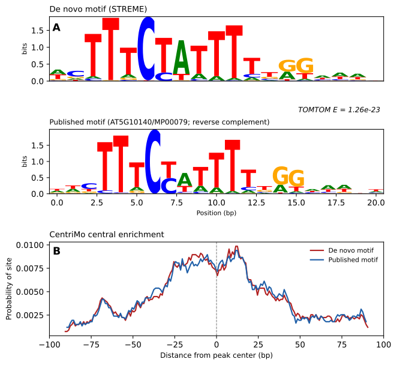

# FLC ChIP-seq Analysis

[](https://github.com/mhajheidari/FLC-ChIP-seq-analysis/actions/workflows/lint.yml)
[](https://github.com/mhajheidari/FLC-ChIP-seq-analysis/actions/workflows/smoke-test.yml)

ChIP-seq analysis pipeline and motif validation for FLOWERING LOCUS C (FLC) in *Arabidopsis thaliana*, accompanying the Plant Methods protocol paper.

## Overview

The analysis runs in three stages, plus an optional signal-to-noise QC step:

1. **`run_ChIPseq_pipeline.sh`** — FastQC → fastp → Bowtie2 → samtools → MACS3 (ChIP vs. matched input, and mock IP vs. pooled input) → MultiQC
2. **`find_and_annotate_reproducible_peaks.R`** — finds peaks reproducible across all four pooled ChIP biological replicates (P1-P4), applies the mock-IP specificity filter, and annotates both peak sets with ChIPseeker
3. **`run_motif_enrichment.sh`** — de novo motif discovery (STREME, MEME), central-enrichment testing (CentriMo), known-motif enrichment (AME), and comparison to the published FLC motif (TOMTOM, FIMO)

Optional QC, run after stage 2: **`signal_to_noise_analysis.sh`** then **`plot_signal_to_noise.R`** — fraction of reads in peaks (FRiP), deepTools fingerprint / Jensen-Shannon distance, fold enrichment at the reproducible peaks, and a summary figure.

## Input data

The pipeline expects paired-end FASTQ files for the ten samples listed in `config.sh` (four pooled ChIP replicates P1-P4, their matched inputs Pi1-Pi4, and two mock IPs C1-C2), plus the *A. thaliana* TAIR10 genome FASTA and GTF annotation. The sequencing data are available from **[add repository and accession number, e.g. GEO/SRA]**. Each user edits `config.sh` and `config.R` (copied from the `.example` files) to point to their own paths; these files are not tracked in git.

## Repository contents

- `run_ChIPseq_pipeline.sh` / `config.sh.example` — stage 1 (bash)
- `find_and_annotate_reproducible_peaks.R` / `config.R.example` — stage 2 (R)
- `run_motif_enrichment.sh` — stage 3 (bash, shares `config.sh` with stage 1)
- `signal_to_noise_analysis.sh` / `plot_signal_to_noise.R` — optional QC after stage 2: FRiP, deepTools fingerprint (JS distance), fold enrichment at the reproducible peaks, and a summary figure (shares `config.sh` / `config.R`)
- `LICENSE` — MIT license; `CITATION.cff` — citation metadata ("Cite this repository" on GitHub)
- `.gitignore` — excludes local config files and large output data from version control
- `motif_analysis_specific/` — STREME, TOMTOM, and CentriMo output, `make_motif_figure.py` to regenerate the summary figure from them, and the resulting `figure1.svg`
- `environment.yml` — conda environment covering every tool used across all three stages
- `tests/generate_test_data.py` — generates a small synthetic dataset (with a real, known motif signal embedded) used by CI to test the pipeline end to end
- `.github/workflows/` — CI: `lint.yml` (fast syntax checks on every push) and `smoke-test.yml` (runs the full pipeline against synthetic data)

## Requirements

**Stage 1 — sequencing QC, alignment, peak calling:**
- bash
- [FastQC](https://www.bioinformatics.babraham.ac.uk/projects/fastqc/)
- [fastp](https://github.com/OpenGene/fastp)
- [Bowtie2](https://bowtie-bio.sourceforge.net/bowtie2/)
- [samtools](https://www.htslib.org/)
- [MACS3](https://github.com/macs3-project/MACS)
- [MultiQC](https://multiqc.info/)

**Stage 2 — reproducible peak finding and annotation (R):**
- [R](https://www.r-project.org/) (>= 4.x)
- Bioconductor: [ChIPseeker](https://bioconductor.org/packages/ChIPseeker/), [GenomicRanges](https://bioconductor.org/packages/GenomicRanges/), [GenomeInfoDb](https://bioconductor.org/packages/GenomeInfoDb/), [txdbmaker](https://bioconductor.org/packages/txdbmaker/), [AnnotationDbi](https://bioconductor.org/packages/AnnotationDbi/), [rtracklayer](https://bioconductor.org/packages/rtracklayer/)

**Stage 3 — motif enrichment:**
- [bedtools](https://bedtools.readthedocs.io/)
- [MEME Suite](https://meme-suite.org/meme/) (provides `streme`, `meme`, `centrimo`, `tomtom`, `ame`, `fimo`)

**Optional signal-to-noise QC:**
- [deepTools](https://deeptools.readthedocs.io/) (`plotFingerprint`), `bc`
- R packages `ggplot2`, `dplyr`, `tidyr`, `patchwork`
- optionally [phantompeakqualtools](https://github.com/kundajelab/phantompeakqualtools) (`run_spp.R`) for strand cross-correlation; it is skipped with a message if not installed

### Recommended: one conda environment for everything

The repository's `environment.yml` installs every tool and R package above (it is the same environment CI uses):

```bash
conda env create -f environment.yml
conda activate flc-chipseq
```

If you prefer to install pieces yourself, the command-line tools are available via conda/mamba, and the R packages via Bioconductor:

```bash
conda create -n chipseq -c conda-forge -c bioconda \
  fastqc fastp bowtie2 samtools macs3 multiqc bedtools meme deeptools
```

```r
install.packages("BiocManager")
BiocManager::install(c("ChIPseeker", "GenomicRanges", "GenomeInfoDb",
                       "txdbmaker", "AnnotationDbi", "rtracklayer"))
install.packages(c("ggplot2", "dplyr", "tidyr", "patchwork"))
```

> **Known issue — CentriMo with conda MEME.** On some systems the conda build of
> the MEME Suite (tested: 5.5.7 and 5.5.9 on Ubuntu) cannot write CentriMo's HTML
> report and fails with `Bad file name.` / `Template does not contain data section`
> (see [bioconda-recipes #22909](https://github.com/bioconda/bioconda-recipes/issues/22909)).
> `run_motif_enrichment.sh` then prints a warning and continues with the other
> steps, but the central-enrichment report is not produced. If this happens, run
> the MEME Suite from the [official Docker image](https://meme-suite.org/meme/doc/install.html)
> or a source build instead. The CI smoke test therefore reports CentriMo as a warning, not a failure.

## Usage

```bash
git clone https://github.com/mhajheidari/FLC-ChIP-seq-analysis.git
cd FLC-ChIP-seq-analysis

# Stage 1
cp config.sh.example config.sh
nano config.sh   # edit paths, genome location, and sample sheet
./run_ChIPseq_pipeline.sh

# Stage 2
cp config.R.example config.R
nano config.R    # edit paths (should match config.sh)
Rscript find_and_annotate_reproducible_peaks.R

# Stage 3
./run_motif_enrichment.sh

# Optional signal-to-noise QC (after stage 2)
./signal_to_noise_analysis.sh
Rscript plot_signal_to_noise.R
```

## Motif validation figure

`motif_analysis_specific/make_motif_figure.py` regenerates the motif comparison figure directly from the STREME/TOMTOM/CentriMo HTML output files produced by stage 3:

```bash
pip install matplotlib numpy pandas logomaker pillow
python make_motif_figure.py --streme streme.html --tomtom tomtom.html --centrimo centrimo.html --out figure1
```



**Figure 1.** Computational validation of the ChIP-seq peaks against the known FLC binding motif. (A) Sequence logo of the de novo motif recovered by STREME, aligned against the published FLC binding motif (PlantTFDB AT5G10140/MP00079), with the TOMTOM match E-value. (B) CentriMo central-enrichment profiles for the de novo motif and the published FLC motif.

## Continuous integration

This repository runs two GitHub Actions workflows automatically (see the badges at the top and the `.github/workflows/` folder):

- **Lint** — runs on every push/PR; checks bash scripts with [ShellCheck](https://www.shellcheck.net/) and parses every `.R`/`.py` file for syntax errors. Fast (no tool installs), catches typos and obvious mistakes in seconds.
- **Smoke test** — runs on push to `main`, on pull requests, and on demand ([Actions tab → "Smoke test (full pipeline)" → "Run workflow"](../../actions/workflows/smoke-test.yml)). Builds the full conda environment from `environment.yml` and runs **all three real pipeline stages** — `run_ChIPseq_pipeline.sh`, `find_and_annotate_reproducible_peaks.R`, `run_motif_enrichment.sh` — plus the signal-to-noise QC, against a small, fully synthetic dataset generated by `tests/generate_test_data.py`. That dataset has a known motif consensus deliberately embedded at 30 positions in a small synthetic genome, with ChIP samples simulated as enriched around those positions and input/mock samples uniform — so the smoke test isn't just checking that the scripts don't crash, it checks that MACS3 actually calls the 30 embedded peaks, that the reproducibility/mock-filtering logic keeps them, that the QC shows clear ChIP-vs-input enrichment (FRiP), and that STREME/TOMTOM/FIMO have a genuine (if trivial) signal to find. This is what actually verifies the pipeline still works end to end, e.g. after a tool update changes a flag or output format. CentriMo is run too, but its result is reported as a warning rather than a failure because of the conda MEME issue described above.

To run the same smoke test locally instead of waiting for CI:

```bash
conda env create -f environment.yml
conda activate flc-chipseq

python3 tests/generate_test_data.py --outdir test_data
fasta-get-markov -m 1 < test_data/test_genome.fa > test_data/bg.txt

# Then create config.sh / config.R pointing at test_data/ (see
# .github/workflows/smoke-test.yml for the exact values used in CI)
# and run all three stages as in Usage above.
```

## Citation

If you use this pipeline, please cite [paper citation once published].

## License

Released under the [MIT License](LICENSE).
